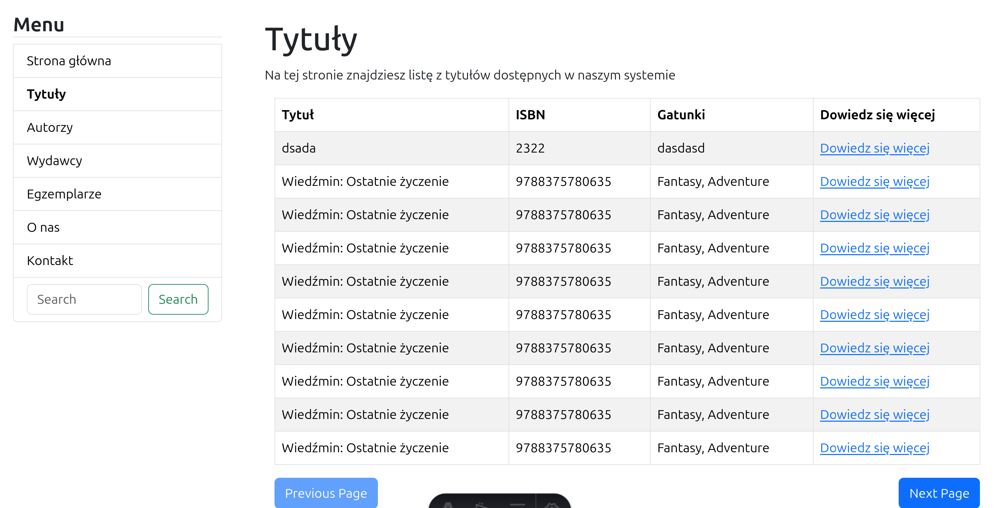
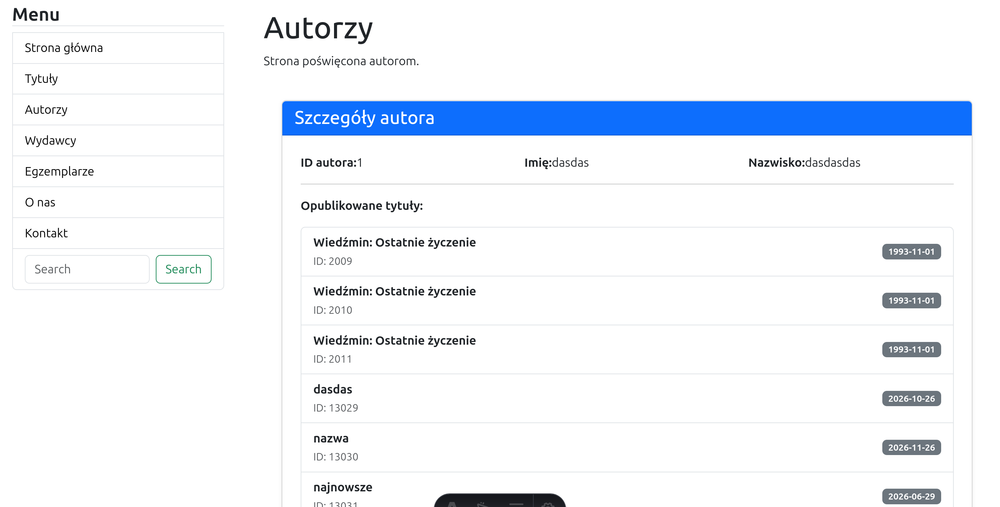
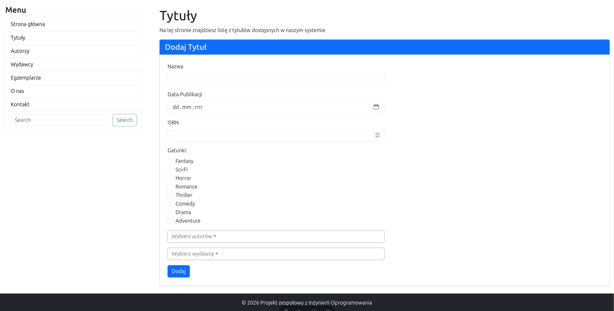

# Library Project PCZ

### Introduction

his project is being developed as part of the "Projekt zespołowy z Inżynierii Oprogramowania" course.

Developed by:

- Jakub Siwek

- Edyta Jarząbek

- Wiktor Wiśniewski

### Presentation

#### All Titles Page


#### Author Details Page


#### Title Create Page


### Project build

In project's directory run:

```bash
docker compose up --build
```

The application will run on ports:

- Frontend: http://localhost:4321
- Backend: http://localhost:5111
- SQL Server: localhost:1433